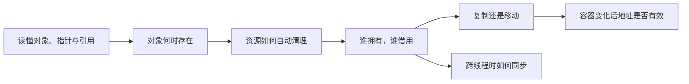
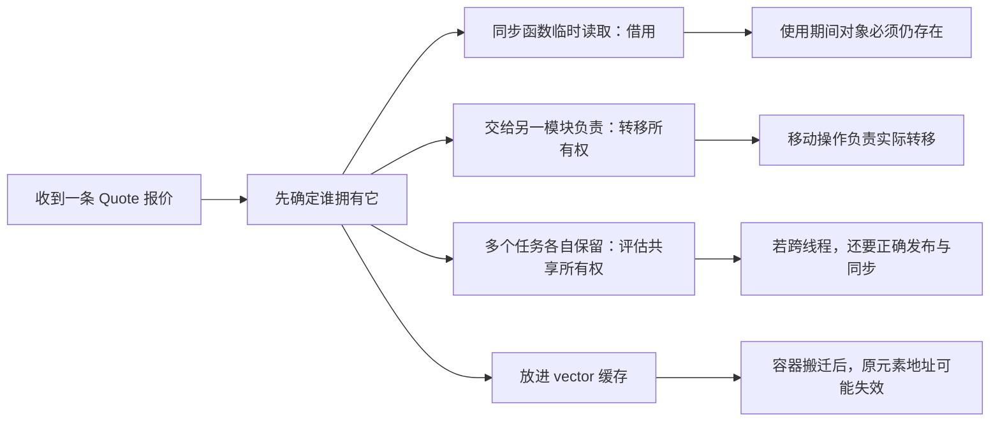

# 2026-10-20 · 从看懂名词到理解生命周期、所有权与容器

← [[README|总入口]] · [[八股测试/2026-10-20|当天测试与原有分数]] · [[题目索引|题目与复习记录]]

> [!abstract] 这一套材料怎么用
> 你已经做完今天的自测，并反馈：很多标准答案中的名词不认识，也不清楚作用和使用场景。这份材料从这些前置概念补起。
>
> **学习页讲“是什么、为什么、怎么用”；测试页保留题目、折叠答案和你已经填写的分数。** 不要求今天把所有专题一次读完。

## 1 先认清今天的主线

假设程序收到一条报价，把它保存起来，交给另一个模块读取，之后再往缓存里添加报价。即使业务很简单，也会遇到六个问题：

1. 报价对应的**对象**在哪里，什么时候存在？
2. 发生错误或提前返回时，**资源**由谁清理？
3. 谁负责让对象继续活着，谁只是临时读取？这是**所有权与借用**。
4. 交给别的模块时，是复制一份数据，还是转移管理责任？这是**复制与移动**。
5. 容器追加元素时，会不会搬到另一块存储，导致原来的地址失效？这是 **vector 的重新分配与引用失效**。
6. 两个线程一起使用时，谁保护对象存活，谁保护数据读写？这是**并发安全**。

这里的“报价”只是承载问题的小例子。换成游戏实体、图片缓冲、网络消息、文件对象，同样会遇到这些问题。



## 2 推荐阅读顺序

先沿着 **00 → 01 → 02 → 03 → 05 → 06** 学一轮。第 04 篇会引入线程、锁与数据竞争，放到后面读也可以。

| 顺序 | 专题 | 读完要能回答的问题 | 对应题目 |
| --- | --- | --- | --- |
| 00 | [[学习/2026-10-20/00-先读懂C++代码与对象\|先读懂 C++ 代码与对象]] | `T*`、`T&`、`const T&`、构造与析构究竟在做什么？ | 全部题的前置 |
| 01 | [[学习/2026-10-20/01-存储期与生命周期\|存储期与生命周期]] | 有一块内存，为什么不等于对象能一直使用？ | CPP-LIFE-001 |
| 02 | [[学习/2026-10-20/02-RAII与异常清理\|RAII 与异常清理]] | 为什么 return 或抛异常后也能自动清理？ | CPP-RAII-001 |
| 03 | [[学习/2026-10-20/03-所有权与智能指针\|所有权与智能指针]] | 谁维持存活、谁负责销毁，怎样选工具？ | CPP-OWN-001 |
| 05 | [[学习/2026-10-20/05-复制移动与值类别\|复制移动与值类别]] | `std::move` 为什么不一定真的移动？ | CPP-MOVE-001 |
| 06 | [[学习/2026-10-20/06-vector与综合练习\|vector 与综合练习]] | size/capacity、扩容、地址失效怎样连起来？ | STL-VECTOR-001、EX-20261020-001 |
| 04 | [[学习/2026-10-20/04-shared_ptr与线程安全\|shared_ptr 与线程安全]] | 引用计数安全为什么不等于业务对象安全？ | CPP-SHARED-001 |

## 3 每一篇怎么学，才不变成另一份背诵材料

### 第一遍：把名词放进代码里

正文按术语、机制、代码和场景展开。看到生词，先停下来找到它指的是**哪个对象、哪份数据、哪条动作**，不要跳过后继续背整句。

例如“观察指针不延长生命周期”可以落到：`int* p = owner.get()` 只是拿到访问入口；`owner.reset()` 销毁对象以后，p 没有让对象继续存活的能力。

### 第二遍：沿着图和代码追踪变化

在纸上画两个框：管理对象一个框，被管理对象另一个框。每执行一行，问“创建了谁、修改了谁、销毁了谁、旧箭头还有效吗”。

### 第三遍：换场景，不只复述原话

把例子里的报价换成文件、图像或网络消息。如果只是在调用期间读取，是否需要共享所有权？如果任务以后才执行，之前借来的引用还能用吗？

### 第四遍：回到原题重新口述

每篇结尾都有压缩后的口述总结。先用自己的话说，再看总结补遗漏。**读过详解不等于已经重新测过，分数由你复测后再改。**

> [!tip] 如果继续保持每天 45–60 分钟
> 一次选择一个专题：读懂一个完整例子，自己改动一个条件，再回测对应原题。长篇详解可以分次完成，不把新增名词全部挤进同一次学习。

## 4 名词速查：先知道它指什么

下表是查词入口，不替代各篇中的代码解释。

| 名词 | 先这样理解 | 去哪里看例子 |
| --- | --- | --- |
| 类型 type | 数据与操作的规则，例如 int、Quote | [[学习/2026-10-20/00-先读懂C++代码与对象\|00 预备篇]] |
| 对象 object | 程序里具有类型、存储和生命周期的实体 | [[学习/2026-10-20/00-先读懂C++代码与对象\|00 预备篇]] |
| 地址 address | 用来定位对象所在存储的位置 | [[学习/2026-10-20/00-先读懂C++代码与对象\|00 预备篇]] |
| 指针 pointer | 可保存指向对象的指针值；变量本身不自动代表所有权 | [[学习/2026-10-20/00-先读懂C++代码与对象\|00 预备篇]] |
| 解引用 dereference | 通过指针访问它指向的对象，如 `*p` | [[学习/2026-10-20/00-先读懂C++代码与对象\|00 预备篇]] |
| 引用 reference | 绑定到已有对象的访问别名，如 `T&` | [[学习/2026-10-20/00-先读懂C++代码与对象\|00 预备篇]] |
| const | 限制通过相应访问路径修改，不自动消除其他可写别名 | [[学习/2026-10-20/00-先读懂C++代码与对象\|00 预备篇]] |
| 作用域 scope | 名字在代码哪个区域可用 | [[学习/2026-10-20/01-存储期与生命周期\|01 生命周期]] |
| 存储期 storage duration | 对象所用存储可以持续多久的分类 | [[学习/2026-10-20/01-存储期与生命周期\|01 生命周期]] |
| 生命周期 lifetime | 对象什么时候开始存在，什么时候结束 | [[学习/2026-10-20/01-存储期与生命周期\|01 生命周期]] |
| 栈 / 堆 stack / heap | 常见实现中管理局部执行存储和动态分配的区域与机制 | [[学习/2026-10-20/01-存储期与生命周期\|01 生命周期]] |
| 悬垂 dangling | 还拿着访问入口，但原对象已不能再通过它使用 | [[学习/2026-10-20/01-存储期与生命周期\|01 生命周期]] |
| 未定义行为 UB | 标准不对这次错误用法的结果作保证，不能推断固定输出 | [[学习/2026-10-20/01-存储期与生命周期\|01 生命周期]] |
| 资源 resource | 用完需要归还或释放的东西，如内存、文件、锁 | [[学习/2026-10-20/02-RAII与异常清理\|02 RAII]] |
| 构造 / 析构 | 建立对象状态 / 执行销毁清理；不直接等同分配 / 释放内存 | [[学习/2026-10-20/02-RAII与异常清理\|02 RAII]] |
| 异常 exception | 报告处理失败并寻找匹配处理器的一种语言机制 | [[学习/2026-10-20/02-RAII与异常清理\|02 RAII]] |
| 栈展开 unwinding | 异常传播去找处理器时，沿途清理已经建立的自动对象 | [[学习/2026-10-20/02-RAII与异常清理\|02 RAII]] |
| RAII | 让管理对象负责在相应生命周期内取得并释放资源 | [[学习/2026-10-20/02-RAII与异常清理\|02 RAII]] |
| 所有权 ownership | 谁负责管理对象存活与最终释放的设计责任 | [[学习/2026-10-20/03-所有权与智能指针\|03 所有权]] |
| 借用 borrowing | 临时访问，不承担维持存活与销毁的责任 | [[学习/2026-10-20/03-所有权与智能指针\|03 所有权]] |
| unique_ptr | 表达独占拥有、可转移的管理对象 | [[学习/2026-10-20/03-所有权与智能指针\|03 所有权]] |
| shared_ptr | 多份管理对象共同维持被管理对象存活 | [[学习/2026-10-20/03-所有权与智能指针\|03 所有权]] |
| weak_ptr | 不延长存活，使用前尝试取得强拥有权 | [[学习/2026-10-20/03-所有权与智能指针\|03 所有权]] |
| 控制块 control block | shared_ptr 共享的计数、删除方式等管理信息 | [[学习/2026-10-20/03-所有权与智能指针\|03 所有权]] |
| 循环引用 | 对象通过强拥有关系互相保活，外部拥有者退出后仍可能不销毁 | [[学习/2026-10-20/03-所有权与智能指针\|03 所有权]] |
| 复制 / 移动 | 按类型定义建立副本 / 从来源取得相应状态或资源 | [[学习/2026-10-20/05-复制移动与值类别\|05 复制移动]] |
| 左值 / 右值 | 表达式的分类，与“写在等号哪边”不能直接等同 | [[学习/2026-10-20/05-复制移动与值类别\|05 复制移动]] |
| std::move | 让后续操作有机会选择移动的转换，本身不搬资源 | [[学习/2026-10-20/05-复制移动与值类别\|05 复制移动]] |
| noexcept | 对外承诺相应调用不让异常逃出；违约会终止程序 | [[学习/2026-10-20/05-复制移动与值类别\|05 复制移动]] |
| vector | 连续存放元素、可改变元素数量的标准容器 | [[学习/2026-10-20/06-vector与综合练习\|06 vector]] |
| size / capacity | 当前已有多少元素 / 不重新分配最多可容纳多少元素 | [[学习/2026-10-20/06-vector与综合练习\|06 vector]] |
| reserve / resize | 请求容量 / 改变实际元素数量 | [[学习/2026-10-20/06-vector与综合练习\|06 vector]] |
| 迭代器 iterator | 用于遍历与定位容器元素的访问工具 | [[学习/2026-10-20/06-vector与综合练习\|06 vector]] |
| 重新分配 reallocation | 换一块元素存储，把原有元素迁移过去 | [[学习/2026-10-20/06-vector与综合练习\|06 vector]] |
| 线程 thread | 程序中可以独立推进的一条执行流 | [[学习/2026-10-20/04-shared_ptr与线程安全\|04 并发]] |
| 数据竞争 data race | 缺少同步的冲突并发访问，至少一方写且至少一方非原子 | [[学习/2026-10-20/04-shared_ptr与线程安全\|04 并发]] |
| 互斥锁 mutex | 让按同一规则加锁的线程轮流进入受保护区域 | [[学习/2026-10-20/04-shared_ptr与线程安全\|04 并发]] |
| 原子 atomic | 不可分割且带相应同步规则的操作，不代表整个业务过程自动安全 | [[学习/2026-10-20/04-shared_ptr与线程安全\|04 并发]] |

## 5 一张贯穿六题的场景图



不要把图当成“所有行情系统都这样设计”。它只是把同一组语言问题放进一个容易追踪的故事；实际架构要按吞吐、延迟、容量和生命周期约定选择。

## 6 代码文件与运行方式

每篇都有完整代码，源文件统一在 `学习/2026-10-20/示例代码`。**Obsidian 的代码框只展示代码，不会执行。** 可以用现有 IDE 创建控制台程序，或者在终端编译单个示例。

2026-10-21 已补充每个源文件的详细中文注释与同名 Markdown。直接打开 [[学习/2026-10-20/示例代码/README|八份代码的 Obsidian 阅读目录]]，即可查看完整注释版、输出观察与自测；原 `.cpp` 继续用于编译。

如果 `g++` 已在 PATH 中，进入示例目录后，例如：

```powershell
g++ -std=c++17 -Wall -Wextra -pedantic 00_objects.cpp -o 00_objects.exe
.\00_objects.exe
```

你的电脑已能找到 GCC 13.1.0，实际程序路径为 `D:\CLion\bin\mingw\bin\g++.exe`。若终端找不到 `g++`，可在 PowerShell 中显式调用：

```powershell
& 'D:\CLion\bin\mingw\bin\g++.exe' -std=c++17 -Wall -Wextra -pedantic 00_objects.cpp -o 00_objects.exe
.\00_objects.exe
```

有多个源文件时，**每次只编译一个**，因为每个示例都有自己的 `main()`。不要把所有示例直接合并成同一个可执行文件。

> [!warning] 哪些代码可以直接运行
> 标为“完整程序”并有对应 `.cpp` 的示例是用于运行的安全版本。短片段用于解释上下文，不保证单独就是完整程序。
> 错误用法放在注释中或明确标为反例；不要为了观察输出取消越界、悬垂解引用、数据竞争等错误语句的注释。未定义行为没有可靠的预期输出。

验证结果与对应输出见 [[学习/2026-10-20/示例验证|示例验证记录]]。

## 7 今天的补学与复测记录

这里记录补学进度；原测试中的分数已保留，不因为生成学习材料而自动提升。

- [ ] 我能读懂指针、引用、const 与构造析构语法。
- [ ] 我能画出管理对象与被管理资源两个框。
- [ ] 我能解释 return 和异常路径下的资源清理。
- [ ] 我能在值、借用、独占、共享之间做一个有理由的选择。
- [ ] 我能把 `std::move` 与真正的移动操作分开。
- [ ] 我能解释 vector 扩容后为什么旧指针不能再用。
- [ ] 我能分清 shared_ptr 管理状态、指针变量、业务对象三层。

| 补学日期 | 专题 | 我之前不懂的名词 | 现在能用什么例子解释 | 复测后仍卡在哪里 |
| --- | --- | --- | --- | --- |
|  |  |  |  |  |

**下一次自测建议：** 先挑前五题中的两题，口述一遍，再改动一个场景条件。只有你实际复测后，再修改 [[八股测试/2026-10-20#自测与复习安排|原测试分数]] 与 [[题目索引|索引]]。

## 8 本次资料依据与范围

语言与库规则优先对照 **C++17 草案 N4659**；工程取舍参考 **C++ Core Guidelines**。各专题把支持具体结论的链接放在相关段落附近，访问核对日期为 **2026-10-20**。

这套资料补全本日六题及练习的主要前置与相关机制，不意味着已经覆盖整个 C++。完整无锁数据结构、内存回收算法、复杂分配器等另开专题，不在本日先塞进一串未经解释的新名词。
