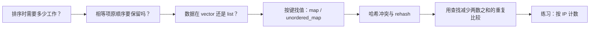

# 2026-10-22 · 把常见面经问法连到代码

← [[README|总入口]] · [[八股测试/2026-10-22|先做今天的题]] · [[知识点台账|知识点台账]]

> [!abstract] 今天为什么是这组题
> 10 月 20 日讲了 C++ 对象、所有权和 vector；21 日讲了继承与多态。今天改从**真实候选人面经中直接出现的常见问法**出发：排序复杂度、两种简单排序、vector/list、map/unordered_map、hash 冲突和两数之和。最后用 IP 计数练习串起键值映射。
>
> 面经只能证明候选人这样记录过题型，不能保证这是公司官方题库或当前流程。原帖、作者与日期在 [[八股测试/2026-10-22#题型确从哪里来|测试页来源表]]；答案另用 C++17 标准条款核对。

## 1 阅读路线：先讲规则，再选容器



每一页先解释名词和用途，再展示中文注释 C++ 程序、图、边界与简短口述。核心说明可见；变式答案折叠。

| 顺序 | 详细学习页 | 先回答的朴素问题 | 今天新增什么 |
| --- | --- | --- | --- |
| 01 | [[学习/2026-10-22/01-快速排序与复杂度\|快速排序]] | 快排为什么平均快，何时最坏？ | 分区、递归深度与稳定性 |
| 02 | [[学习/2026-10-22/02-冒泡选择与稳定性\|冒泡与选择]] | 两种简单排序谁做了什么？ | 比较 / 交换次数与等值项次序 |
| 03 | [[学习/2026-10-22/03-vector与list怎么选\|vector 与 list]] | 第 k 项前插入一定是 list 更快吗？ | list 迭代、已知位置的条件 |
| 04 | [[学习/2026-10-22/04-map与unordered_map\|map 与 unordered_map]] | 两种键值容器怎么选？ | 有序范围查询与平均 / 最坏查找 |
| 05 | [[学习/2026-10-22/05-哈希冲突与rehash\|哈希冲突]] | 不同键同桶会怎样？ | 桶、负载、rehash、失效规则 |
| 06 | [[学习/2026-10-22/06-两数之和与哈希查找\|两数之和]] | 怎样少做重复两两比较？ | “已见值→下标”的查找设计 |
| 07 | [[学习/2026-10-22/07-练习-IP频次\|IP 频次练习]] | 如何找出现最多的 IP？ | 用前面的键值映射综合解题 |

## 2 碰到旧概念，只回顾需要的那一点

| 卡住的地方 | 旧资料入口 |
| --- | --- |
| vector 的连续元素、size/capacity、扩容 | [[学习/2026-10-20/06-vector与综合练习\|10.20 vector]] |
| 引用、迭代器是什么 | [[学习/2026-10-20/00-先读懂C++代码与对象\|基本引用]]、[[学习/2026-10-20/06-vector与综合练习\|迭代器]] |
| 为什么不能继续用已经失效的入口 | [[学习/2026-10-20/01-存储期与生命周期\|对象有效期]] |

今天的 `vector/list` 比较只把**list 的访问与已知位置插入**算新内容；昨天详细讲过的 vector `reserve/resize`、旧 `end()` 和扩容规则不重标“新题”。详解的其它扩展也在 [[知识点台账|台账]] 标记。

## 3 先认这些词，再去读源码

| 词 | 本日先这样理解 | 在哪里用 |
| --- | --- | --- |
| 关键字 key（排序） | 用来比较记录先后的字段；与映射的键是相关但不同用法 | 01、02 |
| 稳定排序 | 比较起来相等的记录仍保留原来的相对顺序 | 01、02 |
| 分区 partition | 按基准把本轮区间拆成左右区域 | 01 |
| 递归 | 函数处理更小的同类问题，直至到达停止条件 | 01 |
| 迭代器 iterator | 用于在容器中定位或遍历元素的访问对象 | 03～05 |
| 随机访问 | 能直接跳到第 k 项，不必从头走 k 步 | 03 |
| 键值对 | 用一个键定位与之关联的数据，如订单 ID→状态 | 04～07 |
| 哈希值 | 哈希函数根据键算出的定位信息 | 05 |
| 桶 bucket | 无序容器用于组织候选元素的单位 | 05 |
| 冲突 collision | 不同键的哈希相同或落入同一桶 | 05 |
| 负载因子 | 元素数 ÷ 桶数 | 05 |
| rehash | 调整桶和元素分布的操作，会影响迭代器 | 05 |
| std::optional | 可以存一份结果，也可以明确表示“没有” | 06、07 |

## 4 两次学习的节奏

**先做测试页的“原帖朴素问法”**：每题先说一个结论和适用条件。答不出来就停在陌生词上，按表进入对应学习页。今天还有 3 道到期旧题复习，单独计时约 5–10 分钟，不算新题。

**再回到代码和图**：例如 vector/list 时先问“位置已经知道吗”，两数之和时先问“当前值的另一半是什么”，不要直接背整段答案。六篇详解比 45–60 分钟的核心自测长，可分多次读完；读过不等于已经复测。

## 5 注释代码与运行

七份代码的目录：[[学习/2026-10-22/示例代码/README|Obsidian Markdown 阅读索引]]。每一份都有详细中文注释 `.cpp`、同名 `.md`、专题正文里的完整代码，三处保持一致。

代码框本身不运行。在示例代码目录中，一次只编译一份，例如：

```powershell
g++ -std=c++17 -Wall -Wextra -pedantic 06_two_sum.cpp -o 06_two_sum.exe
.\06_two_sum.exe
```

编译器找不到时，本机已有 `D:\CLion\bin\mingw\bin\g++.exe`；PowerShell 可写：

```powershell
& 'D:\CLion\bin\mingw\bin\g++.exe' -std=c++17 -Wall -Wextra -pedantic 06_two_sum.cpp -o 06_two_sum.exe
.\06_two_sum.exe
```

本次可运行示例只执行安全输入，错误用法用文字分析。实际构建和观察范围记录在 [[学习/2026-10-22/示例验证]]。

## 6 实际学习与复测记录

- [ ] 我能给出一版快排退化输入并解释比较次数。
- [ ] 我能用两条相等 key 的记录判断排序是否稳定。
- [ ] 我能说清 list 插入 O(1) 的前提。
- [ ] 我能按“是否需要键序”选择映射容器。
- [ ] 我能说明同哈希不等于同键，rehash 不保证修好坏哈希。
- [ ] 我能独立写出“先查差值、后记当前项”。
- [ ] 我做了 IP 计数练习，并处理并列与空输入。

| 实际学习日期 | 专题 | 我原来不懂的词 | 现在能给出的例子 | 仍需复测的条件 |
| --- | --- | --- | --- | --- |
|  |  |  |  |  |

今天的原题和分数表在 [[八股测试/2026-10-22|测试页]]；还未收到你的测试反馈，因此不会替你勾选或填分。
