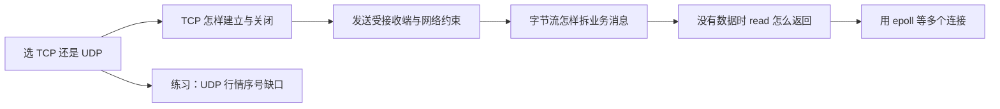

# 2026-10-23 · 从 TCP/UDP 到消息解析与 epoll

← [[README|总入口]] · [[八股测试/2026-10-23|今天先自测]] · [[知识点台账|跨日查重]]

> [!abstract] 今天新增的知识
> 10 月 20 日只讲过线程/锁的入门，21 日讲继承多态，22 日讲排序与容器。今天六题依次学习**传输协议选择、连接生命周期、两类发送约束、TCP 应用消息定界、非阻塞返回值、多 fd 就绪等待**，没有把旧容器题改名重算。小练习把 UDP 特性放进行情序号检查。题型来自 [[八股测试/2026-10-23#题型来源与边界|候选人亲历复盘]]；答案另据 RFC 与 Linux 手册。

## 先认词，再读专题

| 词 | 最初这样理解 | 学习页 |
| --- | --- | --- |
| socket / fd | 操作系统给程序的网络入口 / Linux 为打开资源编号 | 01、05、06 |
| 字节流 / 数据报 | 连续字节、无业务边界 / 一条条有边界的报文 | 01、04 |
| SYN / ACK / FIN | 开始并同步序号 / 确认 / 结束本端发送 | 02 |
| `rwnd` / `cwnd` | 接收端通告的额度 / 发送端对网络的额度 | 03 |
| 半包 / 粘包 | 一次读不足一条 / 一次读含多条；都在应用定界层解决 | 04 |
| `errno` / `EAGAIN` | Linux 系统调用失败后的原因码 / 暂时不能读写 | 05 |
| 就绪 / LT / ET | 可尝试 I/O 的事件 / 水平提醒 / 状态变化提醒 | 06 |
| 序号缺口 | 观察窗口内某个业务编号还未出现 | 07 |

## 学习顺序与代码

每页都能在 Obsidian 中直接看到完整、带中文注释的代码；同一份源码另存 `.cpp` 和同名 `.md`。建议先答对应测试题，卡住时再按下表读。自测加复习控制在约 45–60 分钟，七篇详解可以分多天看。

| 顺序 | 详细学习页 | 最小程序阅读版 | 今天新增的判断 |
| --- | --- | --- | --- |
| 01 | [[学习/2026-10-23/01-TCP与UDP如何选择\|TCP/UDP]] | [[学习/2026-10-23/示例代码/01_tcp_udp\|字节流/报文]] | 交付单位与业务可靠性边界 |
| 02 | [[学习/2026-10-23/02-TCP建立与关闭\|连接生命周期]] | [[学习/2026-10-23/示例代码/02_handshake_close\|序号图]] | 双方确认、半关闭、TIME-WAIT |
| 03 | [[学习/2026-10-23/03-流量控制与拥塞控制\|两种窗口]] | [[学习/2026-10-23/示例代码/03_flow_control\|额度模型]] | 接收端与网络分别限速 |
| 04 | [[学习/2026-10-23/04-TCP消息边界\|消息边界]] | [[学习/2026-10-23/示例代码/04_framing\|分帧解码]] | 半条缓存、多条循环、长度校验 |
| 05 | [[学习/2026-10-23/05-阻塞与非阻塞IO\|非阻塞返回]] | [[学习/2026-10-23/示例代码/05_nonblocking\|返回值分支]] | `recv` 与 `errno` 的分支 |
| 06 | [[学习/2026-10-23/06-select-poll-epoll\|多路复用]] | [[学习/2026-10-23/示例代码/06_epoll_lt_et\|Linux epoll]] | 关注集、LT/ET、读到 EAGAIN |
| 07 | [[学习/2026-10-23/07-练习-UDP序号缺口\|行情练习]] | [[学习/2026-10-23/示例代码/07_udp_sequence\|序号检查]] | 乱序、重复与截止时未观察到 |

## 怎么把术语和代码连起来

从 01 页回答“应用最终收到的是字节还是一条消息”，再读 04 页的 `FrameDecoder`：它为什么必须保留 `pending_`？从 05 页回答“暂时没有数据时会怎样”，再读 06 页的 `epoll_wait` 和非阻塞循环：为什么事件来了还要亲自 `read`？这样每段代码都有要解决的具体问题。

06 的源程序包含 Linux 实际 `epoll` 分支。当前 Windows 上可阅读和编译其提示分支；**Windows 运行成功不能证明 Linux 分支已运行**。验证记录见 [[学习/2026-10-23/示例验证]]。更多代码入口见 [[学习/2026-10-23/示例代码/README|示例代码索引]]。

今天的复习题来自 10 月 22 日，单独写在 [[八股测试/2026-10-23#到期复习 · 不计入六道新题|测试页开头]]。新题分数保持空白，等你实际做完再记。
