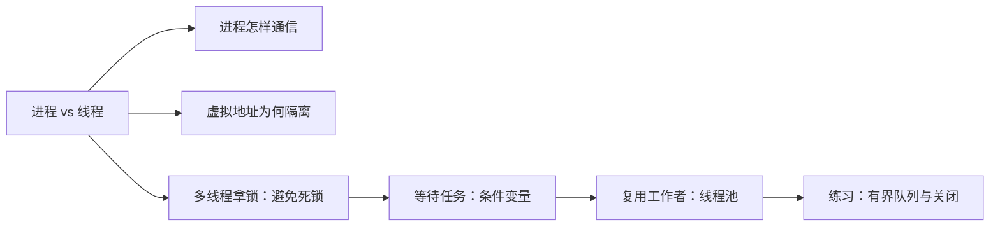

# 2026-10-24 · 从进程边界到线程协作

← [[README|总入口]] · [[八股测试/2026-10-24|今天先自测]] · [[知识点台账|跨日查重]]

> [!abstract] 今天新增什么
> 前几天已讲线程与 mutex 入门、C++ 对象、容器及网络。今天新学**进程隔离、进程间通信、虚拟地址映射、死锁避免、条件变量、线程池结构**；练习把线程池所需的有界队列具体实现出来。旧线程/锁基础只是先修，不算新题。题型来自 [[八股测试/2026-10-24#题型来源与边界|第一手候选人复盘]]；技术结论另查标准和 Linux 文档。

## 先认词

| 词 | 先这样理解 | 对应页 |
| --- | --- | --- |
| 进程 / 线程 | 隔离的运行实例 / 实例内部的执行路径 | 01 |
| 地址空间 / 虚拟地址 | 程序看到的可访问地址范围 / 其中的地址 | 01、03 |
| IPC / pipe / 共享内存 | 跨进程交换数据 / 内核字节通道 / 共同映射区域 | 02 |
| 页 / 页框 / 页表 | 虚拟块 / 物理块 / 两者映射 | 03 |
| mutex / 死锁 | 独占共享状态的锁 / 互等导致无法推进 | 04 |
| 条件变量 / 谓词 | 睡眠等待状态变化 / 判断状态是否满足的布尔条件 | 05 |
| 线程池 / 背压 | 固定工作者复用 / 输入太快时控制积压 | 06、07 |

## 学习顺序与可读代码

先答题，卡住再进详解。每篇正文都嵌完整代码；同一源码另有详细注释的 `.cpp` 与同名 `.md`。六题口述与复习可控制在 45–60 分钟，详细学习不必一天读完。

| 顺序  | 详解                                      | Obsidian 代码阅读版                                         | 新增的判断         |
| --- | --------------------------------------- | ------------------------------------------------------ | ------------- |
| 01  | [[学习/2026-10-24/01-进程与线程\|进程与线程]]    | [[学习/2026-10-24/示例代码/01_process_thread\|线程与 fork]]  | 哪些共享、哪些隔离     |
| 02  | [[学习/2026-10-24/02-进程间通信\|02-进程间通信]]    | [[学习/2026-10-24/示例代码/02_pipe_ipc\|管道]]              | 管道与共享内存各负责什么  |
| 03  | [[学习/2026-10-24/03-虚拟内存\|虚拟内存]]      | [[学习/2026-10-24/示例代码/03_virtual_memory\|页表模型]]      | 页号/偏移/权限      |
| 04  | [[学习/2026-10-24/04-死锁与避免\|死锁]]       | [[学习/2026-10-24/示例代码/04_deadlock\|双锁转账]]            | 等待环与避免策略      |
| 05  | [[学习/2026-10-24/05-条件变量\|条件变量]]      | [[学习/2026-10-24/示例代码/05_condition_variable\|等待与通知]] | 状态、锁、谓词分工     |
| 06  | [[学习/2026-10-24/06-线程池\|线程池]]        | [[学习/2026-10-24/示例代码/06_thread_pool\|工作者与任务队列]]     | 提交、执行、关闭与队列限制 |
| 07  | [[学习/2026-10-24/07-练习-有界队列\|有界队列练习]] | [[学习/2026-10-24/示例代码/07_bounded_queue\|答案源码]]       | 满、空、关闭三种等待    |

## 怎么把知识连起来

01 问“父子进程为什么不能直接改彼此变量”，02 用管道展示跨进程交换，03 解释地址隔离背后的映射。04 再转到同进程共享内存的危险：拿多把锁可能等成环。05 用条件变量让没任务的线程等待，06 将它们组合成线程池；07 再补任务太多和关闭时的边界。

你的 WSL Ubuntu 已实际编译运行所有七段代码，包括 `fork` 与 `pipe` 的 Linux 分支；详见 [[学习/2026-10-24/示例验证|验证记录]]。阅读索引在 [[学习/2026-10-24/示例代码/README|示例代码目录]]。测试分数仍留空，等你实际做完再填。
