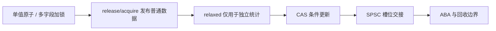

# 2026-10-27 · 原子操作到 SPSC 消息交接

← [[README|总入口]] · [[八股测试/2026-10-27|先自测]] · [[知识点台账|查重台账]]

今天六个新目标从一个原子值到跨线程消息交接：atomic/锁边界 → release/acquire → relaxed 统计 → CAS 重试 → SPSC 环形队列 → ABA 与节点寿命。10/20 数据竞争与 shared_ptr 发布、10/24 mutex/条件变量队列、10/25 伪共享只是先修，不重计新目标。最后一道练习手推容量边界。

## 阅读顺序

先闭卷口述 [[八股测试/2026-10-27|今日六题]]。45–60 分钟可用于自测和前两篇；剩余长文按知识链分次读。示例均按 C++17 编写，完整源码、Markdown 阅读版和专题代码同步。

| 顺序 | 专题详解 | 代码阅读版 | 永久 ID |
| --- | --- | --- | --- |
| 01 | [[学习/2026-10-27/01-原子操作与锁的边界\|原子操作、互斥锁与 volatile 的边界]] | [[学习/2026-10-27/示例代码/01_atomic_mutex\|阅读版]] | CON-ATOM-001 |
| 02 | [[学习/2026-10-27/02-release与acquire交接\|release/acquire 怎样发布一份数据]] | [[学习/2026-10-27/示例代码/02_release_acquire\|阅读版]] | CON-RELEASE-001 |
| 03 | [[学习/2026-10-27/03-relaxed计数与发布边界\|relaxed 计数能保证什么，不能保证什么]] | [[学习/2026-10-27/示例代码/03_relaxed_counter\|阅读版]] | CON-RELAXED-001 |
| 04 | [[学习/2026-10-27/04-CAS与重试\|compare_exchange、失败重试与竞争]] | [[学习/2026-10-27/示例代码/04_cas_max\|阅读版]] | CON-CAS-001 |
| 05 | [[学习/2026-10-27/05-SPSC环形队列\|单生产者单消费者 SPSC 环形队列]] | [[学习/2026-10-27/示例代码/05_spsc_ring\|阅读版]] | CON-SPSC-001 |
| 06 | [[学习/2026-10-27/06-ABA与内存回收\|ABA 与节点内存回收为什么棘手]] | [[学习/2026-10-27/示例代码/06_aba_tag\|阅读版]] | CON-ABA-001 |
| 07 | [[学习/2026-10-27/07-练习-环形队列状态推演\|练习：手推容量 4 的环形队列]] | [[学习/2026-10-27/示例代码/07_ring_trace\|阅读版]] | EX-20261027-001 |

## 术语速查

| 词 | 初学者先这样理解 |
| --- | --- |
| atomic / mutex | 单个对象的不可分访问 / 一段操作的共同门锁 |
| release / acquire | 发布已写数据 / 读到发布信号后接收数据 |
| relaxed | 保留原子性，不建立周边普通数据的交接顺序 |
| CAS / expected | 旧值匹配才更新 / 失败后保存当前观察值 |
| SPSC / head / tail | 单生产单消费 / 下一出队位 / 下一入队位 |
| ABA / 安全回收 | 数值回来但状态变过 / 等读者离开后才释放节点 |

**状态：**本页仅生成学习材料，不代表已学完或已复习；成绩与实际日期留待自测填写。
