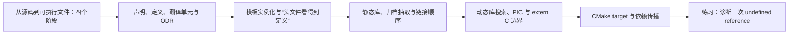

# 2026-10-28 · C++ 从源码到工程构建

← [[README|总入口]] · [[八股测试/2026-10-28|先自测]] · [[知识点台账|查重台账]]

今天的主线把前几天写过的 C++ 代码带进真实项目：编译阶段 → 跨文件定义 → 模板实例化 → 静态库 → 动态库与 ABI → CMake 目标依赖。10/20–10/27 的对象、容器、并发、I/O 知识只作例子，不重新计新题。

## 阅读顺序

先闭卷答 [[八股测试/2026-10-28|今日六题]]，再按下表补弱点。45–60 分钟用于自测、复习和前两篇；后面长文可分次学完。每篇都解释术语、实际故障、完整注释源码、Mermaid 图和边界。

| 顺序 | 专题详解 | 代码阅读版 | 永久 ID |
| --- | --- | --- | --- |
| 01 | [[学习/2026-10-28/01-编译四阶段\|从源码到可执行文件：四个阶段]] | [[学习/2026-10-28/示例代码/01_build_stages\|代码阅读版]] | BUILD-STAGE-001 |
| 02 | [[学习/2026-10-28/02-声明定义与ODR\|声明、定义、翻译单元与 ODR]] | [[学习/2026-10-28/示例代码/02_declaration_odr\|代码阅读版]] | BUILD-ODR-001 |
| 03 | [[学习/2026-10-28/03-模板实例化\|模板实例化与“头文件看得到定义”]] | [[学习/2026-10-28/示例代码/03_template_instantiation\|代码阅读版]] | BUILD-TEMPLATE-001 |
| 04 | [[学习/2026-10-28/04-静态库与链接顺序\|静态库、归档抽取与链接顺序]] | [[学习/2026-10-28/示例代码/04_static_archive\|代码阅读版]] | BUILD-ARCHIVE-001 |
| 05 | [[学习/2026-10-28/05-动态库与ABI\|动态库搜索、PIC 与 extern C 边界]] | [[学习/2026-10-28/示例代码/05_shared_abi\|代码阅读版]] | BUILD-SHARED-001 |
| 06 | [[学习/2026-10-28/06-CMake目标与依赖\|CMake target 与依赖传播]] | [[学习/2026-10-28/示例代码/06_cmake_target\|代码阅读版]] | BUILD-CMAKE-001 |
| 07 | [[学习/2026-10-28/07-练习-链接错误诊断\|练习：诊断一次 undefined reference]] | [[学习/2026-10-28/示例代码/07_link_diagnosis\|代码阅读版]] | EX-20261028-001 |

## 术语速查

| 术语 | 初学者先这样理解 |
| --- | --- |
| 翻译单元 | 一个 .cpp 加上预处理后包含进来的内容 |
| 声明 / 定义 | 告知名字与类型 / 真正提供实体或函数体 |
| 模板实例化 | 按具体类型生成或要求具体函数/类 |
| 静态归档 .a | 多个目标文件装在一起，链接时按需要抽取 |
| 动态对象 .so | 程序运行时仍要由装载器找到的依赖 |
| ABI | 二进制层面的符号、调用与对象约定 |
| CMake target | 构建图中的库或程序节点，带有自己的使用要求 |

**状态：**仅创建资料，未替用户填写成绩或复习记录。
