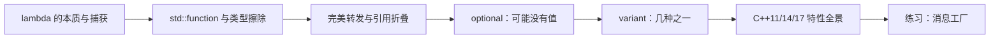

# 2026-10-30 · 现代 C++：lambda、可调用对象与接口类型

← [[README|总入口]] · [[八股测试/2026-10-30|先自测]] · [[知识点台账|查重台账]] · [[面经核验-2026-10-30|原帖核验]]

今天讲“现代 C++ 写接口”这条线：**lambda 是闭包对象 → std::function 做类型擦除 → 完美转发保证参数不丢值类别 → optional 表达可能没有 → variant 表达几种之一 → 最后一题把 C++11 到 C++17 的特性串起来**。

与旧题的分工：10-20 讲了移动语义与智能指针，10-21 讲了虚函数与多态，今天不重复；这里讲的是**回调与数据表达**这一组现代写法。模板推导的细节（SFINAE、偏特化）不再单独占题，留在追问里。

## 阅读顺序

45–60 分钟建议：自测 → 复习 → 01/02 → 04；03、05、06 与练习可分两次。

| 顺序 | 专题详解 | 代码阅读版 | 永久 ID |
| --- | --- | --- | --- |
| 01 | [[学习/2026-10-30/01-lambda的本质与捕获\|lambda 的本质与捕获]] | [[学习/2026-10-30/示例代码/01_lambda_function\|代码阅读版]] | GEN-LAMBDA-001 |
| 02 | [[学习/2026-10-30/02-std-function与类型擦除\|std::function 与类型擦除]] | 同上 | GEN-FUNCTION-001 |
| 03 | [[学习/2026-10-30/03-完美转发与引用折叠\|完美转发与引用折叠]] | [[学习/2026-10-30/示例代码/03_forwarding\|代码阅读版]] | GEN-FORWARD-001 |
| 04 | [[学习/2026-10-30/04-optional与缺失值\|optional 与缺失值]] | [[学习/2026-10-30/示例代码/02_optional_variant\|代码阅读版]] | GEN-OPTIONAL-001 |
| 05 | [[学习/2026-10-30/05-variant与事件类型\|variant 与事件类型]] | 同上 | GEN-VARIANT-001 |
| 06 | [[学习/2026-10-30/06-C++11-14-17特性\|C++11/14/17 特性全景]] | 文中片段 | CPP11-FEATURES-001 |
| 07 | [[学习/2026-10-30/07-练习-消息工厂\|练习：消息工厂]] | 同 03 | EX-20261030-001 |

## 术语速查

| 术语 | 先用一句话理解 |
| --- | --- |
| 闭包类型 | 编译器为 lambda 生成的唯一类 |
| 类型擦除 | 对外统一接口、内部隐藏具体类型 |
| 转发引用 | 模板里的 `T&&`，左右值都能接 |
| 引用折叠 | `&`/`&&` 组合后“有 & 就是 &” |
| `std::forward` | 按记录的类型转发，保留值类别 |
| `optional<T>` | 有值或没有值 |
| `variant<Ts...>` | 同一时刻持有其中一种类型 |
| `visit` | 按当前类型分派处理函数 |

**状态：**仅创建资料，未替用户填写成绩或复习记录。

## 这一天的来源与边界

- 直接问法：[声网 Linux 流媒体 C++ 面经](https://www.nowcoder.com/feed/main/detail/38a87df1514f48b187cc7e2234656b73)（lambda 捕获、与 `std::function` 区别）、[快手游戏服务端一面](https://www.nowcoder.com/discuss/620359211850977280)（模板函数、完美转发、`noexcept`）、[快手 C++ 开发一面](https://www.nowcoder.com/feed/main/detail/1a21d6c707fc428e929a03cf1dfeebfe)（完美转发如何实现）、[京东 C++ 面经](https://www.iamshuaidi.com/31040.html)（C++11 新特性、右值引用、move）。
- 仅索引、未加载全文：[影石 2025-07-15](https://www.nowcoder.com/feed/main/detail/753bcacd2c7c45b0aa5ba80af8b7fe3c)（optional 场景）、[某量化实习 2023-09-13](https://www.nowcoder.com/discuss/473626483991281664)（variant）、[字节存储 2025-05-18](https://www.nowcoder.com/discuss/753649991486279680)（`sizeof(std::function)`）。
- `noexcept` 在 10-20 已作为移动语义的一部分讲过，今天只在追问里提，不重复计新题。
