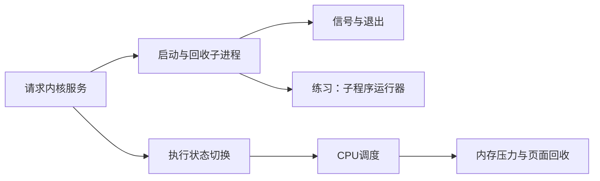

# 2026-10-31 · Linux 程序运行与资源管理

← [[README|总入口]] · [[八股测试/2026-10-31|先自测]] · [[知识点台账|跨日查重]]

今天按 Linux/操作系统通用能力展开六个不同侧面。10月24日的fork基本返回值、进程线程区别和页表映射，10月26日的LRU容器仅作先修；新增的是系统调用权限边界、退出与回收、信号处理、执行状态切换、调度指标、FIFO/Clock页面置换。

## 先认词

| 术语 | 普通解释 |
| --- | --- |
| 系统调用 | 程序向内核申请服务的入口 |
| exec / wait | 用新程序替换自己 / 收取子进程状态 |
| 僵尸 / 孤儿 | 已退出但待回收 / 父进程先退出而被接管 |
| 信号 | 内核或其他任务送达的事件通知 |
| 上下文 | 暂停后还能接着执行所需的状态 |
| 响应 / 周转 | 首次得到CPU要等多久 / 到全部完成要多久 |
| 牺牲页 / 引用位 | 为腾空间选择回收的页 / 近期访问标记 |

## 学习与代码入口

| 顺序 | 学习页 | 注释代码阅读版 | 新增目标 |
| --- | --- | --- | --- |
| 1 | [[学习/2026-10-31/01-用户态与系统调用\|用户态、内核态与系统调用]] | [[学习/2026-10-31/示例代码/01_syscall\|源码与解释]] | 特权边界、受控入口、库包装与系统调用/任务切换的区别 |
| 2 | [[学习/2026-10-31/02-子进程与退出回收\|子进程退出后为什么还要 wait]] | [[学习/2026-10-31/示例代码/02_process_lifecycle\|源码与解释]] | exec与创建的区别、退出状态编码、僵尸/孤儿与回收责任 |
| 3 | [[学习/2026-10-31/03-信号与安全退出\|kill 与 kill -9，以及信号处理边界]] | [[学习/2026-10-31/示例代码/03_signal\|源码与解释]] | 信号默认动作与捕获限制、异步信号安全、正常流清理 |
| 4 | [[学习/2026-10-31/04-上下文切换\|上下文切换保存什么，成本在哪里]] | [[学习/2026-10-31/示例代码/04_context_switch\|源码与解释]] | 执行状态保存恢复、自愿/非自愿切换、观测值与性能结论边界 |
| 5 | [[学习/2026-10-31/05-CPU调度策略\|CPU 调度策略怎样取舍]] | [[学习/2026-10-31/示例代码/05_scheduler\|源码与解释]] | FCFS/SJF/RR/优先级策略、响应与周转、时间片和饥饿 |
| 6 | [[学习/2026-10-31/06-页面置换策略\|内存不够时为什么要选择换出页]] | [[学习/2026-10-31/示例代码/06_page_replacement\|源码与解释]] | FIFO/Clock选择、Belady异常、页回收与写回的边界 |
| 7 | [[学习/2026-10-31/07-练习-子进程运行器\|综合：子进程运行器]] | [[学习/2026-10-31/示例代码/07_child_runner\|源码与解释]] | 启动、等待、退出原因与错误路径 |

建议先看01–03，再看04–06。每次只学一两篇也可以，最后回测试页用自己的话解释。真实题型证据在 [[八股测试/2026-10-31#题型来源与边界|来源表]]；例子中具体场景与数字均由本库设计。

代码采用C++17；进程、信号、资源统计部分需要Linux，调度与页面置换是用户态模拟，不修改系统策略、不耗尽机器内存。运行结果见 [[学习/2026-10-31/示例验证]]；代码目录在 [[学习/2026-10-31/示例代码/README]]。
